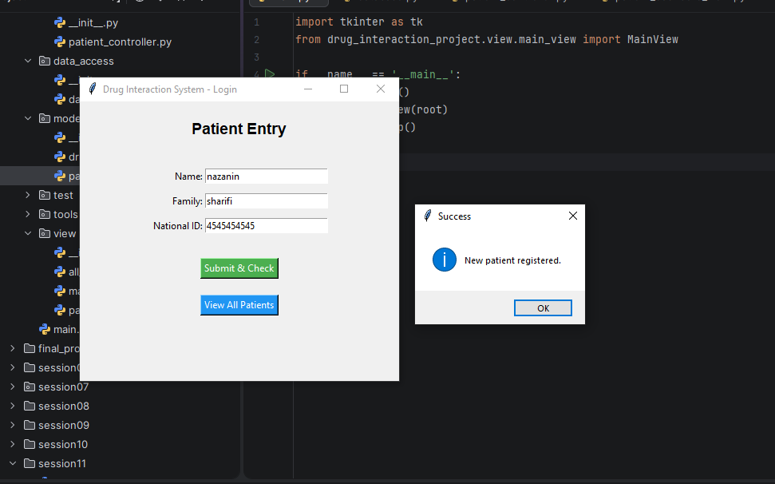
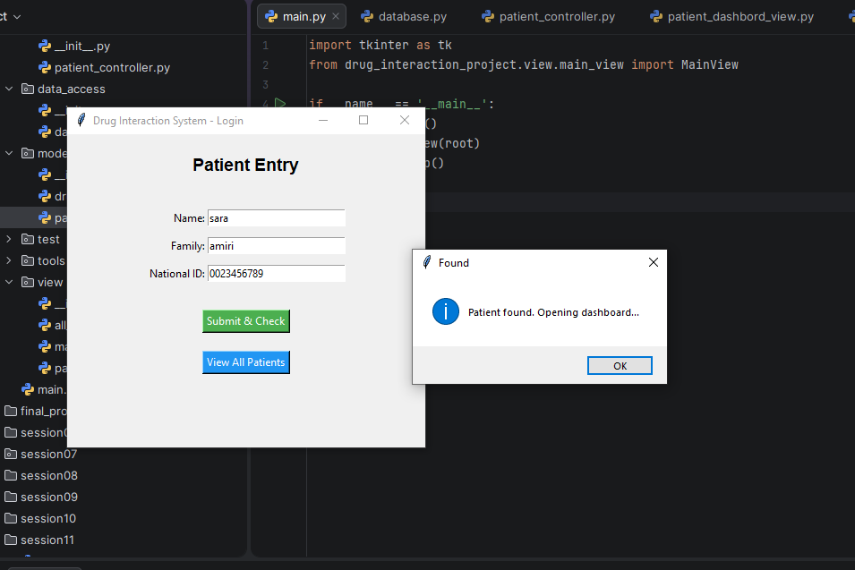
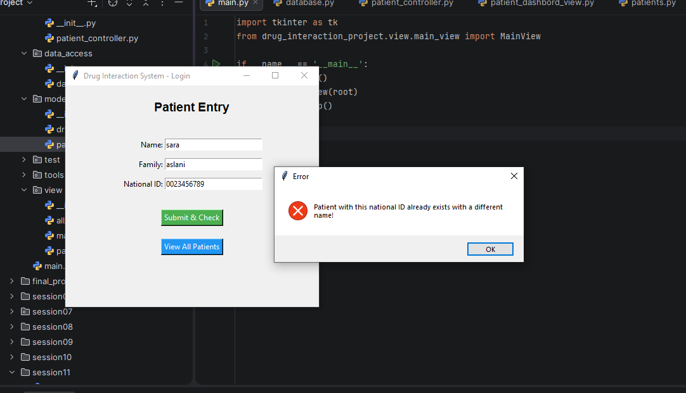
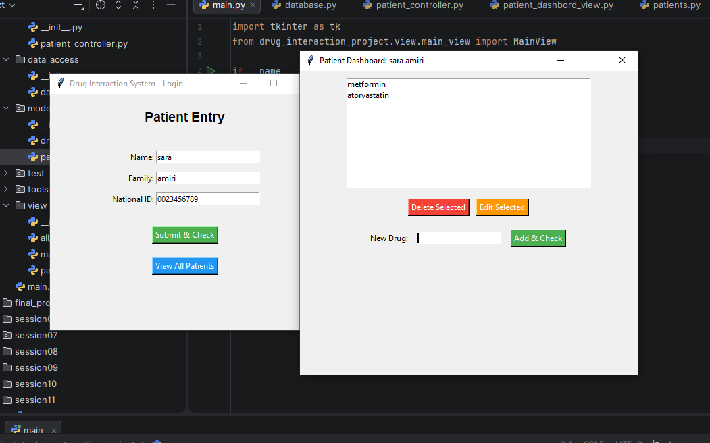
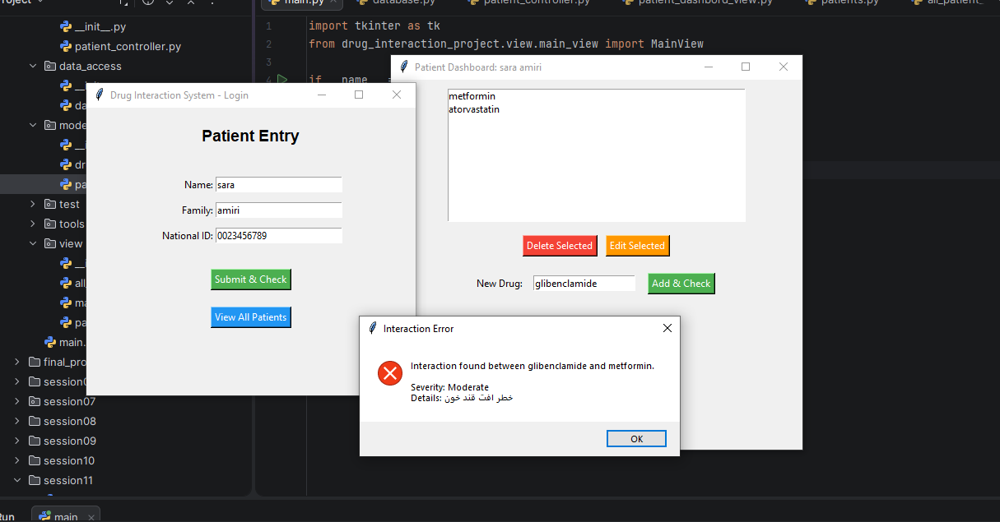
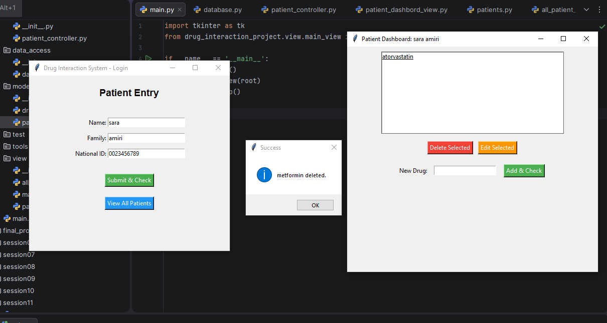
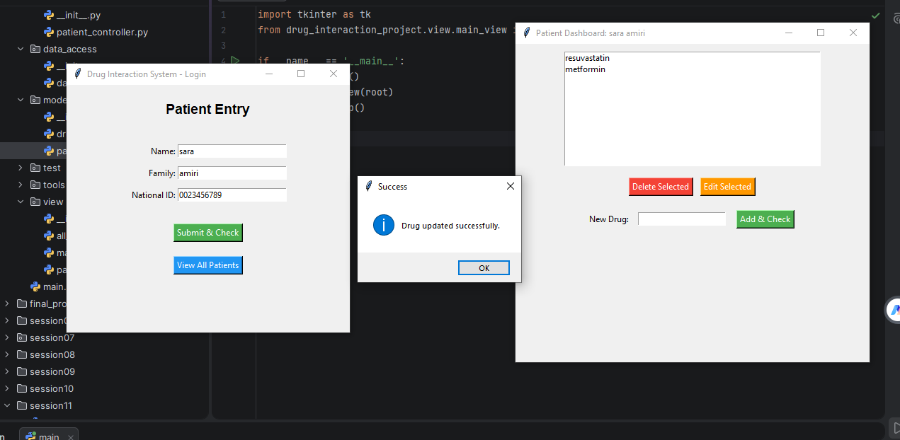
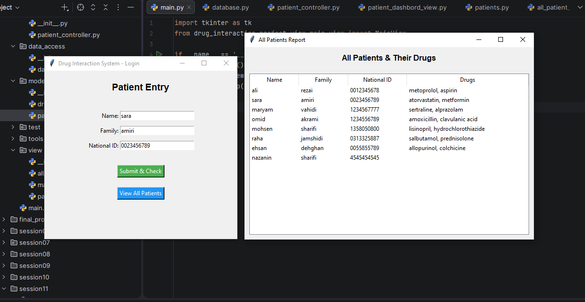
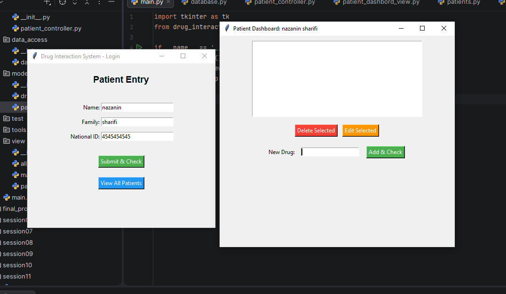

# drug_interaction_project
# Drug Interaction System 

این سیستم یک نرم‌افزار دسکتاپ برای مدیریت بیماران و بررسی تداخلات دارویی است که با رعایت کامل اصول **شی‌گرایی (OOP)** و معماری **MVC (Model-View-Controller)** طراحی و پیاده‌سازی شده است.

##  امکانات کلیدی
- **مدیریت بیماران:** ثبت بیمار جدید با اعتبارسنجی هوشمند (کد ملی و نام) و جلوگیری از ثبت کد ملی تکراری.
- **مدیریت داروها:** افزودن، حذف و ویرایش داروهای هر بیمار.
- **بررسی تداخل دارویی:** تشخیص خودکار تداخلات خطرناک (Major و Moderate) بین داروی جدید و داروهای فعلی بیمار.
- **گزارش‌گیری:** مشاهده جدول کامل تمام بیماران و داروهای مصرفی آن‌ها.

##  ساختار پروژه (MVC)
- **`model/`**: شامل کلاس‌های اصلی داده (`Patient` و `Drug`).
- **`data_access/`**: مدیریت دیتابیس در حافظه به صورت Singleton (`Database`).
- **`business_logic/`**: منطق بررسی تداخل دارویی (`InteractionService`).
- **`controller/`**: ارتباط بین رابط کاربری و منطق برنامه (`PatientController`).
- **`view/`**: رابط‌های گرافیکی با `Tkinter` (صفحات ورود، داشبورد و گزارش).
- **`tools/`**: ابزارهای اعتبارسنجی ورودی‌ها (`Validator`).

## تصاویر برنامه

### ۱. ثبت بیمار جدید

### ۲. پیدا کردن بیمار قبلی

### ۳. جلوگیری از ثبت کد ملی تکراری

### ۴. باز شدن لیست داروهای بیمار

### ۵. بررسی تداخل دارویی

### ۶. حذف و ویرایش دارو

### ۷. گزارش کل بیماران

### ۸. باز شدن پنجره برای بیمار جدید

